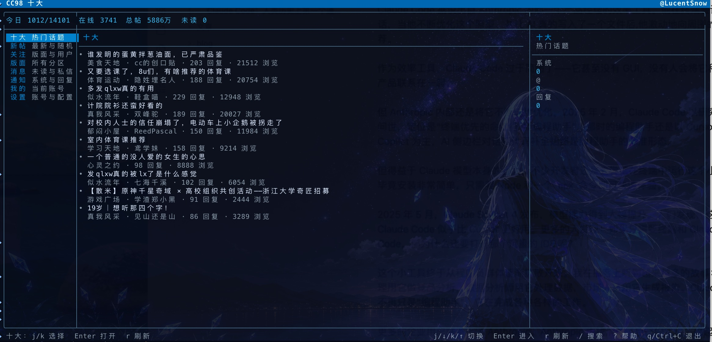

# CC98-CLI

CC98 的命令行客户端，包含面向脚本使用的 CLI 和适合日常浏览的 TUI。

- 直接运行 `cc98` 进入终端界面。
- 带参数运行 `cc98 <command>` 执行 CLI，默认输出 JSON。
- 支持多账号、本地缓存、WebVPN、帖子搜索、通知、私信、收藏、关注、回复和赞踩等常用操作。

本项目基于 CC98 的公开接口实现，与 CC98 官方无关。请合理使用本工具，避免违反 CC98 的用户协议。

## 预览

<p align="center">
  
</p>

## 安装

需要 Node.js 20+。

```bash
npm install -g cc98-cli
```

## 登录

```bash
cc98 login
```

多账号：

```bash
cc98 account list
cc98 account use <name>
cc98 --account <name> me
```

非校园网访问可使用 WebVPN：

```bash
cc98 vpn login
cc98 vpn status
cc98 vpn mode auto
```

### 经本地代理使用（Clash / V2Ray 等）

Node 的原生 `fetch` 默认**不读取** `HTTP_PROXY` / `HTTPS_PROXY` 环境变量，因此即便终端里代理变量已生效，cc98 仍会直连访问，可能导致校园网检测失败或 API 不可达。Node ≥ 24 可通过以下方式让 `fetch` 跟随代理环境变量：

```bash
export NODE_USE_ENV_PROXY=1   # 可写入 ~/.zshrc 持久化
```

若你的代理规则能把 `api.cc98.org`、`mirrors.zju.edu.cn` 送入校园网出口（例如通过 RVPN / WebVPN 网关分流），则无需再配置本工具的 WebVPN 模式。

## TUI

```bash
cc98
```

左栏导航包含：十大、新帖、关注、版面、消息、通知、我的、设置。其中“新帖”包含最新、随机、推荐三个标签，“关注”包含关注版面、关注用户、追踪更新三个标签。

### 快捷键

| 键 | 作用 |
|----|------|
| `j/k` 或 `↑/↓` | 上下移动 |
| `l`、`→` 或 `Enter` | 进入或打开 |
| `h`、`←` 或 `Esc` | 返回或关闭 |
| `/` | 搜索帖子、用户或当前内容 |
| `Tab` / `Shift+Tab` | 切换标签或搜索类型 |
| `r` | 刷新或换一批 |
| `R` | 回复当前帖子或私信 |
| `o` | 打开当前上下文操作菜单 |
| `?` | 显示帮助 |
| `q` 或 `Ctrl+C` | 退出 |

帖子阅读页还支持：

| 键 | 作用 |
|----|------|
| `{` / `}` | 上一页 / 下一页 |
| `[` / `]` | 上一楼 / 下一楼 |
| 数字 + `g` | 跳到指定页 |
| 数字 + `G` | 跳到指定楼 |
| `n/N` | 在内容搜索结果间跳转 |

### 操作菜单

帖子阅读页只保留高频导航快捷键，低频和上下文操作统一通过 `o` 菜单进入。

| 菜单 | 操作 |
|------|------|
| 楼层 | 赞、踩、打开图片、复制图片、复制链接、复制楼层内容 |
| 用户 | 查看用户资料 |
| 帖子 | 收藏/取消收藏、复制帖子链接 |

## 搜索

`/` 打开搜索框后可在三种类型间切换：

- 帖子：全站搜索；在版面内或帖子内可切换为当前版面搜索。
- 用户：按用户名搜索。
- 内容：搜索当前中栏已加载内容，支持高亮和 `n/N` 跳转。

## CLI

CLI 默认输出 JSON，适合配合 `jq` 或脚本使用。

```bash
cc98 me
cc98 me signin
cc98 forum boards
cc98 board <board-id>
cc98 topic <topic-id>
cc98 topic new
cc98 topic random
cc98 topic recommendation
cc98 topic create <board-id> <title> <content>
cc98 topic reply <topic-id> <content>
cc98 search <keyword>
cc98 user profile <user-id>
cc98 user search <name>
cc98 message recent
cc98 notice system
cc98 update
```

查看完整命令：

```bash
cc98 --help
cc98 topic --help
cc98 user --help
cc98 message --help
cc98 vpn --help
```

## 本地数据

登录信息和缓存保存在：

```text
~/.cc98-cli/
```

Token、WebVPN 账号密码、Cookie 和缓存文件都保存在本机。WebVPN 配置文件权限为 `0600`，仅当前用户可读写。

执行 `cc98 vpn login` 后，账号密码和会话 Cookie 会保存到本地。WebVPN 会话过期时，客户端会自动使用已保存的账号密码重新登录并更新 Cookie；无需重复输入。

## 从源码运行

```bash
npm install
npm run check
npm run build
node dist/main.js
```

## 致谢

- [Ansherly](https://github.com/Ansherly)：感谢前辈的积极鼓励。
- [CC98-Desktop](https://github.com/Ansherly/CC98-Desktop)：部分 TUI 信息架构参考了该桌面客户端的交互设计。

## License

MIT
